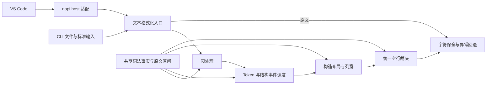
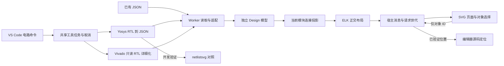
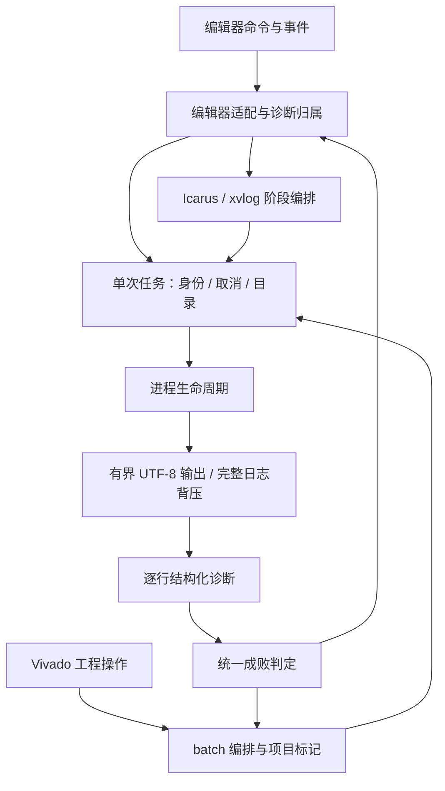

# SV Tools 4.x 架构

## 技术方向

保留 JavaScript CommonJS 的 VS Code 集成和 Rust 格式化核心。编辑器、工具链、波形和 Vivado 集成位于 `src/`，Rust crate 位于 `src/native/`，发布产物位于 `bin/`。VS Code 与 CLI 复用相同格式化入口。

格式化器按原文词法扫描、预处理、结构状态、布局、空行裁决组织。字符串和注释通过原文区间保护，各构造的布局规则独立；词法事实共享，布局策略不混入扫描器。结构状态和调度动作使用枚举，输出状态仅在一次格式化会话中存在。

每一阶段都遵守原文保护合同：结构识别可以屏蔽受保护的内容，但输出必须从原文区间取值。主循环的保护 token 不能替代后续对齐器的保护；对齐器重新识别文本时也要复用同一词法事实。

alpha12增加不可配置的输出提交条件：仅忽略ASCII空格/Tab/CR/LF，其余字符的值、
数量和顺序必须与该入口原文相同。Rust `format_guard` 用无中间副本的迭代比较约束
全文、普通段、兼容beautifier及选区对齐；捕获布局异常并回退原文。NAPI先严格读取
UTF-16，孤立代理项返回原始JS字符串，避免在守卫之前被UTF-8转换替换。编辑器的
`format-safety.js`在全文/选区和对齐替换之前按UTF-16复核，保护旧或错误native边界。
模块实例、Testbench、头部和重复代码等生成命令保留其新增/改写语义。

## 模块边界

| 模块 | 负责 | 不负责 |
|---|---|---|
| `source_scan` | 字符串、注释、宏、转义标识符、括号与分隔符事实 | 缩进、列宽、换行策略 |
| `preprocess` | 按代码区安全切分和归一语句 | 编辑器、工具进程 |
| `formatter/state` 与 `structure` | 类型化上下文及语句分类 | 原生模块加载、文件写入 |
| `formatter/session` 与布局模块 | 单次调用的缩进、续行、输出提交 | 跨请求共享可变状态 |
| `align/*` | 构造的列宽和布局，按原文区间重建 | 提前裁决用户空行 |
| `blank_rules` | 空行配置与结构边界 | 改写字面量或注释正文 |
| `format_guard` | 四种ASCII布局字符外的序列校验，异常与不安全候选回退 | 语法识别、布局配置、纠正乱码编码 |
| `bindings` | Rust 与 napi-rs 调用适配、布局入口的无损UTF-16边界 | 格式化规则 |
| `src/editor/format-safety.js` | 编辑器替换前的UTF-16字符保全 | 原生算法、代码生成政策 |
| `src/toolchains/process.js` | 进程启动、完成、超时和终止 | 输出存储、引擎参数、FPGA 诊断语义 |
| `src/toolchains/output.js` | UTF-8 解码、有界摘要、逐行回调、日志背压 | 编译成败、编辑器更新 |
| `src/toolchains/job.js` | 任务身份、取消、进程槽、独立目录和清理 | 编译参数、诊断规则 |
| `src/toolchains/result.js` 与 `diagnostics.js` | 统一成败、全工程错误、有界结构化诊断 | VS Code API、产物删除 |
| `src/toolchains/compile-policy.js` | lint/详细化阶段超时的唯一配置来源 | 仿真运行时限 |
| `src/toolchains/iverilog-runner.js` 与 `xvlog-runner.js` | 引擎阶段编排、依赖补编译、产物判定 | 编辑器事件和状态栏 |
| `src/toolchains/iverilog-controller.js` | 命令、事件、诊断归属和界面接线 | 进程字节流、厂商解析规则 |
| `src/vivado/batch.js` | batch 成败、项目标记与语义错误 | 工程树、Tcl 生成 |
| `src/workspace/sources.js` | 设计单元索引与缓存 | Lint 运行与界面接线 |
| `src/workspace/source-policy.js` | 工程与补全共享的生成目录排除规则 | 任务目录创建、语义解析 |
| `src/circuit/model.js` 与 `adapters/*` | 工具无关领域合同、Yosys/Vivado 方言转换与验证 | 布局坐标、Webview、工具进程 |
| `src/circuit/projection.js` 与 `layout.js` | 当前模块连接投影、有界总线合并、ELK 几何 | 领域位序改写、文件读取、编辑器状态 |
| `src/circuit/worker.js` 与 `session.js` | UTF-8 JSON 读取、模型、布局、RPC 容量/超时/销毁 | VS Code API、外部工具启动 |
| `src/circuit/*-runner.js` 与 `source-request.js` | 本地工具参数、任务快照、源位置回映射 | 电路推断、SVG 绘制 |
| `src/circuit/host.js` 与 `index.js` | 页面生命周期、命令、取消和受限源码定位 | 网表方言、布局算法 |
| `src/circuit/client.js` 与 `renderer.js` | 纯文本详情、手势、SVG 和页面状态 | 文件路径访问、启动工具、解析 RTL |
| `src/editor/completion/catalog` 与生成数据 | 版本化规范名称、公开接口签名和来源/许可 | 用户工程解析和 VS Code API |
| `src/editor/completion/syntax` | 容错词法、作用域、声明、类型与连接区间 | 规范目录、文件读取、完整 elaboration |
| `src/editor/completion/index` | 文档版本缓存、工程/include 目录事件与容量预算 | 补全排序和原生格式化 |
| `src/editor/completion/resolve` 与 `engine` | 词法可见性、泛型/成员解析、上下文候选、前缀与数量预算 | VS Code 类和文件读取 |
| `src/editor/completion/provider` | 编辑器配置、取消、双替换区间与 SnippetString | 重复维护标准名录和领域类型规则 |

固定声明/赋值模式使用惰性缓存。新增规则优先落在负责该构造的模块，只有新的词法事实才扩展扫描器；不能把某个布局例外复制到其它阶段。

## 4.1 电路数据与交互

alpha2 默认使用固定版本内置 Yosys WASM。alpha4将前端选择集中在runner：auto在内置后端解析为Slang，在外部后端解析为旧Verilog前端；显式配置始终保留，不按关键字改写输入或失败后重试。源位置前缀的ERROR也使任务失败，摘要优先具体错误，完整日志保留运行时警告。`yosys-bundled.js` 仅构建源目录/include/任务目录的 guest 路径映射；`yosys-wasi.js` 在独立 Node 子进程校验并运行原始 WASI 模块。编译进程继承共享工具任务的超时、日志和取消，不占用扩展宿主线程，也不在运行时下载工具。资源及完整许可由构建脚本从锁定 npm 包复制/展开；不分发该包的 JS runtime、Python 或其它 WASM adapter。Node WASI 用于接口与进程隔离，不宣称安全沙箱。

内置 Slang 的 `src` 可能省略开头斜杠，适配时先按 guest 根解析，再经目录映射与快照映射两步还原真实文件。编辑器标题栏默认Yosys；RTL右键选择当前文件Vivado top，工程面板沿用工程top。alpha3修正原先仅传`-top`的缺口：工程旧层级会AutoDisabled无关源，只读原工程无法重算。当前文件入口先在任务目录`save_project_as -exclude_run_results`，确认当前项目已切到副本后仅在副本设置top并`update_compile_order`。原工程及源码不变；工程外或脏正文仍明确提示改用内置Yosys。Tcl导出器显式按UTF-8加载，错误汇总优先具体Vivado诊断而非Tcl收尾。

alpha5将页面热路径分成两个纯索引：`graph-index.js`管理模块拓扑、搜索文本与位别名，`viewport.js`管理静态包围盒树和折线相交查询。renderer只保留带过扫描边界的可见对象在活动SVG中；屏外DOM与数据仍由索引持有，重入保持原始绘制顺序、已选状态与对象身份。选择只写入前后状态的差集；搜索不重复构造文本。

client只持有相机逻辑状态，requestAnimationFrame每帧提交一次最新变换。视口几何在换图和ResizeObserver中更新，滚轮不再同步读取布局。换图、加载、取消与销毁清理待提交帧；手动相机在窗口变化后重裁剪，保持缩放和平移。缩小总览逐级隐藏不可读细节，正常倍率恢复；不将裁剪推入领域模型或ELK，不提高硬预算。

技术方向是先验证工具实际输出，再建立独立模型，最终使用 ELK.js + SVG 提供交互。netlistsvg 只用于开发验证，正式页面不依赖其输出或内部对象。实现愿景是同一模型接入不同工具并支持局部逻辑浏览；当前交付模块级视图，逻辑锥和增量布局留作后续。

模型中的位引用只在所属模块内有意义，数组为 LSB-first；坐标和 ELK ID 不进入领域模型。模块输入在内部连接图中是驱动端，但声明方向仍为 input，投影显式保留二者，避免布局语义污染详情。别名、常量、多驱动和未知方向保持事实，不能补造连接。

每个面板独立 Worker，首次导入和导航有请求世代检查；关闭/刷新取消所属工具任务，旧布局和源码响应不能覆盖新页面。Worker 读取上限 64 MiB、堆预算 384 MiB、单请求 60 秒；单模块展示预算在投影前检查。模块目录先于布局发送，超大顶层报错后仍可选小模块。Webview 不接收可执行路径，仅发送已有对象 ID；nonce CSP、纯文本写入和宿主真实路径校验共同约束边界。完整预算及未实现范围见 `docs/CIRCUIT.md`。

## 实现愿景

4.0 延续 3.x 的编辑器命令、格式化默认样例和工具链功能，修正会改变程序内容或违背配置合同的行为。开发只发生在独立 worktree，原目录继续维护 3.x。

验收包括默认 golden 全文比对、幂等性、完整格式化管线的字符串/注释/宏保护和配置组合测试、Rust 单元测试、工具进程生命周期测试以及 VSIX 文件清单校验。编译通过不替代编辑器宿主与 FPGA 工具的实际运行验证。

## 已确认的重构动机

- 原主循环同时维护词法状态、布局缓冲、缩进、换行和对齐调度，修改规则需要追踪多处隐含状态。
- 预处理曾把 UTF-8 字节转为字符，也曾将注释关键词用于合并 `begin`，损坏源码。
- 对齐器提前删除空行，使最终空行 pass 无法履行保持配置。
- 标点使用 `Box::leak` 转换为字符串，重复格式化留下永久分配。
- 工具进程的超时和 Windows 进程树终止在多个引擎中重复实现。

## 开发边界

本次从提交 `49f54f97119a996991d40a059b01a0ae589e85db` 建立 4.0。3.x 未提交内容不复制。格式化规则以 `docs/FORMAT_SPEC.md` 与全文回归共同约束；变更行为时同时更新规范和案例。只对真实存在的重复职责抽取模块，不建立通用插件框架。

## 后续约束

4.0.0-alpha2 将波形解析放入单文件 worker；增量 parser 与紧凑 store 独立于页面。
host 只转发信号元数据、有界时间窗、精确游标及边沿查询；client 管交互与持久化，
renderer 管可见行绘制，model 管纯视图规则。目录和 Canvas 均按视口工作。
alpha3 新增 memory 视图；`memory.js` 只建立索引分组和有界页，`memory-view.js` 管矩阵交互、
当前页精确读值与过期响应。它复用 values 服务，不改变事件存储，也不展开所有地址组合。
索引分组只引用已 dump 的信号，packed bit 的原引用由 parser 保留；显示名称继续兼容。
详细操作、数据合同与 100/500 MiB 实测见 `docs/WAVEFORM.md`。

alpha7 将浮点位域与解码集中到 `waveform/value-format.js`；`model.js` 提供统一格式目录和
适用性，菜单、状态恢复与 memory 使用相同裁决。选择与分组纯规则独立于 DOM，菜单层
只管理层级、焦点和定位，client 仍拥有操作目标与持久化。格式切换和同可见信号的重排
复用原查询结果；仅可见 ID、时间窗或游标改变时更新查询。renderer 只决定主题文字、
轮廓与安全缩略，不承担位值解码。没有新增运行依赖或改动 VCD 存储。

alpha8 将行高、插入边界与动画位置的纯计算放入 `row-layout.js`，Pointer 生命周期放入
`row-gesture.js`。预览与提交分开：手势模块持有临时位置和取消快照，client 在完成手势后
刷新查询并保存布局；renderer 按临时视觉位置绘制可见行。模拟量缩放与名称区排序共用
指针捕获和取消边界，Canvas 位图仍由视口尺寸决定。

alpha11 将目录与名称/A-B栏的宽度裁决集中到 `column-layout.js`，Canvas、分隔线和采样
预算共用同一几何；`column-resize.js` 只拥有 Pointer/键盘生命周期。保存请求宽度与当前
有效宽度分开，视口缩窄不覆盖用户偏好。client 接线预览、提交与取消；拖动只重绘，完成
后才按绘图区像素更新窗口请求，精确游标值继续复用缓存。目录原来的原生底角 resize
改为整条边界，以同一取消和保存规则处理两个面板；没有新增运行依赖。

声明、端口和过程赋值仍采用词法与正则驱动的布局规则，没有完整 SystemVerilog AST。
共享扫描保证保护区不被重新解释，并不能证明所有语法构造都已覆盖。端口表与 task/function
参数表已共用分隔符识别；各自的列宽策略暂留在所属模块，避免把历史规则硬塞入通用框架。

当前验收针对 Windows x64。alpha4 已执行真实 Icarus 编译/vvp/VCD、xvlog/xelab 和 Vivado
batch 验证；真实 VS Code 宿主交互与其它平台仍需独立验证。本地开发版本的后续发布通过
分支审查和发布流程完成。

## alpha4 工具链任务合同

任务先注册，再准备目录和探测工具；同文档的新检查取消旧检查，新仿真取消旧仿真。
替换任务等待前任释放，避免旧阶段写入新产物。不同文档用不同目录；每个任务管理器最多
运行两个阶段进程，排队取消不会启动工具。关闭文档、修改内容、切换配置和释放扩展均
有明确的取消入口。引擎读取任务状态，只有当前任务可发布诊断和触发自动波形查看。

每个触发文档拥有其本轮诊断，Problems 合并各文档的依赖诊断；修复或关闭一个文档不会
清掉另一个文档仍持有的错误。主文件错误数量与任务总错误数量分别表示；成功要求正常
退出、全工程无错误且诊断完整。启动失败、超时、日志失败和跳过均不能成为“通过”。
流式解析保留早期错误和缺失依赖，输出摘要截断不会影响依赖补编译。

本轮修改前的风险与对应边界如下，保留可复核的具体原因：

| 风险 | 原实现中的原因 | alpha4 的处理 |
|---|---|---|
| R1 认知过载 | Icarus 激活函数同时包含编译、仿真、诊断与事件处理 | 分离 runner/controller，探测和 Cygwin 重试单独命名 |
| R2 变更传播 | 调整取消要逐引擎检查阶段、状态栏和共享文件 | 任务拥有阶段生命周期，引擎复用取消信号 |
| R3 知识重复 | 多个流程各自认定成功与超时 | 统一 result 与编译超时策略，保留不同资源的独立预算 |
| R4 偶发复杂性 | 共享 .prj/xsim.dir 与临时文件需要额外代次补丁 | 每次任务创建独立目录，清理只涉及自己创建的内容 |
| R5 依赖失序 | 引擎流程与 VS Code API 交织，验证需加载宿主 | runner 通过显式边界获得配置和发布能力，基础进程模块不依赖 VS Code |
| R6 模型扭曲 | 主文件零错误或准备失败被表示为 ok | success/failed/cancelled/skipped 分离，全工程错误影响成败 |

静态工具仍会把组合入口内多个命名回调的分支相加，把 Node 内建依赖计入扇出，把
诊断数量 2000 与终止时限 2000ms、行预算与日志队列预算视为重复。人工审查按职责和
单位区分这些告警，不以总分替代结论；同一编译超时的真实重复已合并。编辑器事件接线
仍集中在 controller，后续扩展应新增明确的边界服务，避免重新加入引擎内部流程。

本轮未引入统一 CompilePlan 或增量源码索引；索引沿用既有刷新策略。独立 xvlog 目录
只复用一次任务内的增量编译，跨任务缓存需要内容和配置键才能安全恢复。操作、预算与
验收边界见 `docs/TOOLCHAINS.md`、`docs/V4_ALPHA4.md`。

## alpha5 工程管理边界

`vivado/projects.js` 是工程树与编辑器命令的工程选择来源。显式选择保存在 workspaceState，
自动发现顺序固定且在当前工程有效时保持选择；删除的显式选择显示错误，避免悄悄换到
另一工程。异步 stat 结果按选择代次检查，不覆盖后来的选择。

`vivado/xpr.js` 先验证完整 UTF-8 XML 1.0 Project，再提取文件集/top/器件；实体、属性顺序、
普通相对路径与 file URL 在一个入口处理。半写 XML 不作为部分工程发布，写操作仍经 Tcl。
`workspace/sources.js` 提供受保护文本屏蔽及设计单元原文区间；工程模型复用这些事实。

`vivado/tree-model.js` 只读取所选 XPR 成员，生成无 VS Code 对象的树快照。文件清单与
源码层级预览各有身份，仿真中只引用设计集的单元标为 referenceModule，不允许直接进行
成员删除/移动。单元区间内才建立实例/包引用，循环、重复定义和预算超限明确显示。
模型只预览源码，不求解宏、generate、IP 或参数详细化。

`vivado/projectTree.js` 适配 TreeItem、数据事件和父节点；刷新单次执行并合并最新请求，
只提交最新快照，释放后不发迟到更新。管理命令有忙碌门禁、取消 Picker、工程/成员前置
核验、独立动作目录和写后事实校验。编辑器增量入口共享工程和忙碌状态，不复用正在
执行的脚本。详细化把选中集成员、真实 top 与源码目录传给 xvlog，停止按实际任务路由。

修改前的 R1/R2 是数据构建与命令/界面交织、工程发现与脚本文件多处共享；R3 是各命令
自行推断文件集与工作区；R4 是全工作区逐单元正则与并发刷新；R5 是模型依赖 VS Code；
R6 是把源码文件引用当完整模块层级、把仿真引用当文件集成员。本轮对应边界已拆分并
以合同、真实宿主和工具验证约束。创建向导/OOC/报告集成仍位于既有组合入口，后续
变更应沿这些边界继续分离，不能把引擎或模型内部状态重新塞回事件接线函数。
