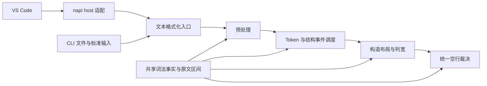

# SV Tools 4.0 架构

## 技术方向

保留 JavaScript CommonJS 的 VS Code 集成和 Rust 格式化核心。编辑器、工具链、波形和 Vivado 集成位于 `src/`，Rust crate 位于 `src/native/`，发布产物位于 `bin/`。VS Code 与 CLI 复用相同格式化入口。

格式化器按原文词法扫描、预处理、结构状态、布局、空行裁决组织。字符串和注释通过原文区间保护，各构造的布局规则独立；词法事实共享，布局策略不混入扫描器。结构状态和调度动作使用枚举，输出状态仅在一次格式化会话中存在。

每一阶段都遵守原文保护合同：结构识别可以屏蔽受保护的内容，但输出必须从原文区间取值。主循环的保护 token 不能替代后续对齐器的保护；对齐器重新识别文本时也要复用同一词法事实。

## 模块边界

| 模块 | 负责 | 不负责 |
|---|---|---|
| `source_scan` | 字符串、注释、宏、转义标识符、括号与分隔符事实 | 缩进、列宽、换行策略 |
| `preprocess` | 按代码区安全切分和归一语句 | 编辑器、工具进程 |
| `formatter/state` 与 `structure` | 类型化上下文及语句分类 | 原生模块加载、文件写入 |
| `formatter/session` 与布局模块 | 单次调用的缩进、续行、输出提交 | 跨请求共享可变状态 |
| `align/*` | 构造的列宽和布局，按原文区间重建 | 提前裁决用户空行 |
| `blank_rules` | 空行配置与结构边界 | 改写字面量或注释正文 |
| `bindings` | Rust 与 napi-rs 调用适配 | 格式化规则 |
| `src/toolchains/process.js` | 输出解码、完成、超时和终止 | 引擎参数、FPGA 诊断语义 |
| `src/workspace/sources.js` | 设计单元索引与缓存 | Lint 运行与界面接线 |

固定声明/赋值模式使用惰性缓存。新增规则优先落在负责该构造的模块，只有新的词法事实才扩展扫描器；不能把某个布局例外复制到其它阶段。

## 实现愿景

4.0 延续 3.x 的编辑器命令、格式化默认样例和工具链功能，修正会改变程序内容或违背配置合同的行为。开发只发生在独立 worktree，原目录继续维护 3.x。

验收包括默认 golden 全文比对、幂等性、完整格式化管线的字符串/注释/宏保护和配置组合测试、Rust 单元测试、工具进程生命周期测试以及 VSIX 文件清单校验。编译通过不替代编辑器宿主与 FPGA 工具的实际运行验证。

## 已确认的重构动机

- 原主循环同时维护词法状态、布局缓冲、缩进、换行和对齐调度，修改规则需要追踪多处隐含状态。
- 预处理曾把 UTF-8 字节转为字符，也曾将注释关键词用于合并 `begin`，损坏源码。
- 对齐器提前删除空行，使最终空行 pass 无法履行保持配置。
- 标点使用 `Box::leak` 转换为字符串，重复格式化留下永久分配。
- 工具进程的超时和 Windows 进程树终止在多个引擎中重复实现。

## 开发边界

本次从提交 `49f54f97119a996991d40a059b01a0ae589e85db` 建立 4.0。3.x 未提交内容不复制。格式化规则以 `docs/FORMAT_SPEC.md` 与全文回归共同约束；变更行为时同时更新规范和案例。只对真实存在的重复职责抽取模块，不建立通用插件框架。

## 后续约束

4.0.0-alpha2 将波形解析放入单文件 worker；增量 parser 与紧凑 store 独立于页面。
host 只转发信号元数据、有界时间窗、精确游标及边沿查询；client 管交互与持久化，
renderer 管可见行绘制，model 管纯视图规则。目录和 Canvas 均按视口工作。
alpha3 新增 memory 视图；`memory.js` 只建立索引分组和有界页，`memory-view.js` 管矩阵交互、
当前页精确读值与过期响应。它复用 values 服务，不改变事件存储，也不展开所有地址组合。
索引分组只引用已 dump 的信号，packed bit 的原引用由 parser 保留；显示名称继续兼容。
详细操作、数据合同与 100/500 MiB 实测见 `docs/WAVEFORM.md`。

声明、端口和过程赋值仍采用词法与正则驱动的布局规则，没有完整 SystemVerilog AST。
共享扫描保证保护区不被重新解释，并不能证明所有语法构造都已覆盖。端口表与 task/function
参数表已共用分隔符识别；各自的列宽策略暂留在所属模块，避免把历史规则硬塞入通用框架。

当前验收针对 Windows x64：VS Code 宿主交互、真实 Vivado/Icarus 工作流和其它平台仍需
独立验证。4.0.0-alpha1 为本地开发验收版本，后续发布通过分支审查和发布流程完成。
