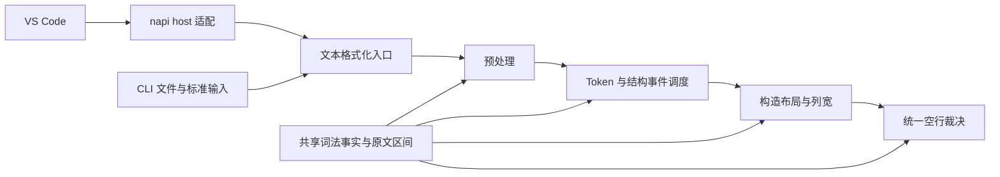
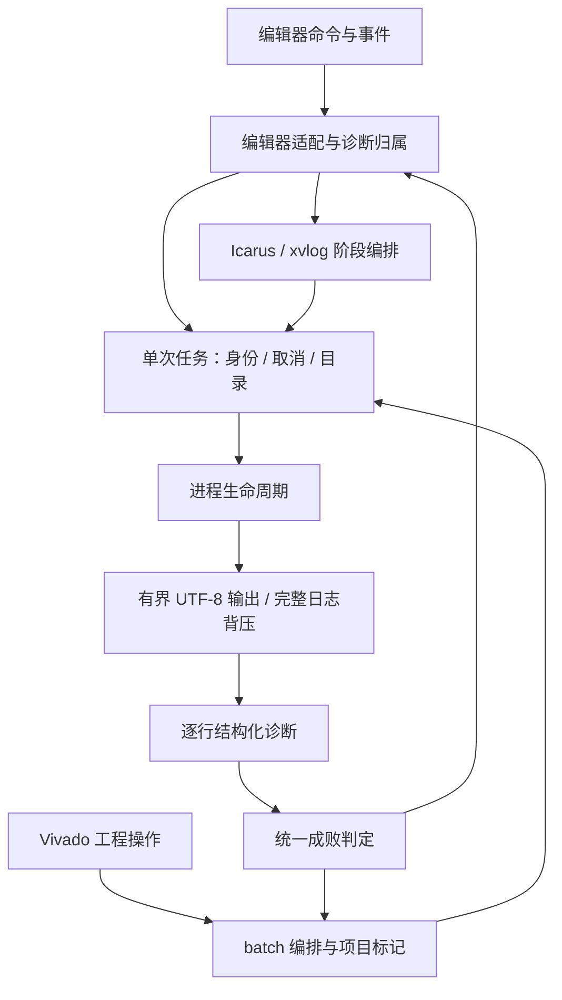

# SV Tools 4.0 架构

## 技术方向

保留 JavaScript CommonJS 的 VS Code 集成和 Rust 格式化核心。编辑器、工具链、波形和 Vivado 集成位于 `src/`，Rust crate 位于 `src/native/`，发布产物位于 `bin/`。VS Code 与 CLI 复用相同格式化入口。

格式化器按原文词法扫描、预处理、结构状态、布局、空行裁决组织。字符串和注释通过原文区间保护，各构造的布局规则独立；词法事实共享，布局策略不混入扫描器。结构状态和调度动作使用枚举，输出状态仅在一次格式化会话中存在。

每一阶段都遵守原文保护合同：结构识别可以屏蔽受保护的内容，但输出必须从原文区间取值。主循环的保护 token 不能替代后续对齐器的保护；对齐器重新识别文本时也要复用同一词法事实。

## 模块边界

| 模块 | 负责 | 不负责 |
|---|---|---|
| `source_scan` | 字符串、注释、宏、转义标识符、括号与分隔符事实 | 缩进、列宽、换行策略 |
| `preprocess` | 按代码区安全切分和归一语句 | 编辑器、工具进程 |
| `formatter/state` 与 `structure` | 类型化上下文及语句分类 | 原生模块加载、文件写入 |
| `formatter/session` 与布局模块 | 单次调用的缩进、续行、输出提交 | 跨请求共享可变状态 |
| `align/*` | 构造的列宽和布局，按原文区间重建 | 提前裁决用户空行 |
| `blank_rules` | 空行配置与结构边界 | 改写字面量或注释正文 |
| `bindings` | Rust 与 napi-rs 调用适配 | 格式化规则 |
| `src/toolchains/process.js` | 进程启动、完成、超时和终止 | 输出存储、引擎参数、FPGA 诊断语义 |
| `src/toolchains/output.js` | UTF-8 解码、有界摘要、逐行回调、日志背压 | 编译成败、编辑器更新 |
| `src/toolchains/job.js` | 任务身份、取消、进程槽、独立目录和清理 | 编译参数、诊断规则 |
| `src/toolchains/result.js` 与 `diagnostics.js` | 统一成败、全工程错误、有界结构化诊断 | VS Code API、产物删除 |
| `src/toolchains/compile-policy.js` | lint/详细化阶段超时的唯一配置来源 | 仿真运行时限 |
| `src/toolchains/iverilog-runner.js` 与 `xvlog-runner.js` | 引擎阶段编排、依赖补编译、产物判定 | 编辑器事件和状态栏 |
| `src/toolchains/iverilog-controller.js` | 命令、事件、诊断归属和界面接线 | 进程字节流、厂商解析规则 |
| `src/vivado/batch.js` | batch 成败、项目标记与语义错误 | 工程树、Tcl 生成 |
| `src/workspace/sources.js` | 设计单元索引与缓存 | Lint 运行与界面接线 |

固定声明/赋值模式使用惰性缓存。新增规则优先落在负责该构造的模块，只有新的词法事实才扩展扫描器；不能把某个布局例外复制到其它阶段。

## 实现愿景

4.0 延续 3.x 的编辑器命令、格式化默认样例和工具链功能，修正会改变程序内容或违背配置合同的行为。开发只发生在独立 worktree，原目录继续维护 3.x。

验收包括默认 golden 全文比对、幂等性、完整格式化管线的字符串/注释/宏保护和配置组合测试、Rust 单元测试、工具进程生命周期测试以及 VSIX 文件清单校验。编译通过不替代编辑器宿主与 FPGA 工具的实际运行验证。

## 已确认的重构动机

- 原主循环同时维护词法状态、布局缓冲、缩进、换行和对齐调度，修改规则需要追踪多处隐含状态。
- 预处理曾把 UTF-8 字节转为字符，也曾将注释关键词用于合并 `begin`，损坏源码。
- 对齐器提前删除空行，使最终空行 pass 无法履行保持配置。
- 标点使用 `Box::leak` 转换为字符串，重复格式化留下永久分配。
- 工具进程的超时和 Windows 进程树终止在多个引擎中重复实现。

## 开发边界

本次从提交 `49f54f97119a996991d40a059b01a0ae589e85db` 建立 4.0。3.x 未提交内容不复制。格式化规则以 `docs/FORMAT_SPEC.md` 与全文回归共同约束；变更行为时同时更新规范和案例。只对真实存在的重复职责抽取模块，不建立通用插件框架。

## 后续约束

4.0.0-alpha2 将波形解析放入单文件 worker；增量 parser 与紧凑 store 独立于页面。
host 只转发信号元数据、有界时间窗、精确游标及边沿查询；client 管交互与持久化，
renderer 管可见行绘制，model 管纯视图规则。目录和 Canvas 均按视口工作。
alpha3 新增 memory 视图；`memory.js` 只建立索引分组和有界页，`memory-view.js` 管矩阵交互、
当前页精确读值与过期响应。它复用 values 服务，不改变事件存储，也不展开所有地址组合。
索引分组只引用已 dump 的信号，packed bit 的原引用由 parser 保留；显示名称继续兼容。
详细操作、数据合同与 100/500 MiB 实测见 `docs/WAVEFORM.md`。

声明、端口和过程赋值仍采用词法与正则驱动的布局规则，没有完整 SystemVerilog AST。
共享扫描保证保护区不被重新解释，并不能证明所有语法构造都已覆盖。端口表与 task/function
参数表已共用分隔符识别；各自的列宽策略暂留在所属模块，避免把历史规则硬塞入通用框架。

当前验收针对 Windows x64。alpha4 已执行真实 Icarus 编译/vvp/VCD、xvlog/xelab 和 Vivado
batch 验证；真实 VS Code 宿主交互与其它平台仍需独立验证。本地开发版本的后续发布通过
分支审查和发布流程完成。

## alpha4 工具链任务合同

任务先注册，再准备目录和探测工具；同文档的新检查取消旧检查，新仿真取消旧仿真。
替换任务等待前任释放，避免旧阶段写入新产物。不同文档用不同目录；每个任务管理器最多
运行两个阶段进程，排队取消不会启动工具。关闭文档、修改内容、切换配置和释放扩展均
有明确的取消入口。引擎读取任务状态，只有当前任务可发布诊断和触发自动波形查看。

每个触发文档拥有其本轮诊断，Problems 合并各文档的依赖诊断；修复或关闭一个文档不会
清掉另一个文档仍持有的错误。主文件错误数量与任务总错误数量分别表示；成功要求正常
退出、全工程无错误且诊断完整。启动失败、超时、日志失败和跳过均不能成为“通过”。
流式解析保留早期错误和缺失依赖，输出摘要截断不会影响依赖补编译。

本轮修改前的风险与对应边界如下，保留可复核的具体原因：

| 风险 | 原实现中的原因 | alpha4 的处理 |
|---|---|---|
| R1 认知过载 | Icarus 激活函数同时包含编译、仿真、诊断与事件处理 | 分离 runner/controller，探测和 Cygwin 重试单独命名 |
| R2 变更传播 | 调整取消要逐引擎检查阶段、状态栏和共享文件 | 任务拥有阶段生命周期，引擎复用取消信号 |
| R3 知识重复 | 多个流程各自认定成功与超时 | 统一 result 与编译超时策略，保留不同资源的独立预算 |
| R4 偶发复杂性 | 共享 .prj/xsim.dir 与临时文件需要额外代次补丁 | 每次任务创建独立目录，清理只涉及自己创建的内容 |
| R5 依赖失序 | 引擎流程与 VS Code API 交织，验证需加载宿主 | runner 通过显式边界获得配置和发布能力，基础进程模块不依赖 VS Code |
| R6 模型扭曲 | 主文件零错误或准备失败被表示为 ok | success/failed/cancelled/skipped 分离，全工程错误影响成败 |

静态工具仍会把组合入口内多个命名回调的分支相加，把 Node 内建依赖计入扇出，把
诊断数量 2000 与终止时限 2000ms、行预算与日志队列预算视为重复。人工审查按职责和
单位区分这些告警，不以总分替代结论；同一编译超时的真实重复已合并。编辑器事件接线
仍集中在 controller，后续扩展应新增明确的边界服务，避免重新加入引擎内部流程。

本轮未引入统一 CompilePlan 或增量源码索引；索引沿用既有刷新策略。独立 xvlog 目录
只复用一次任务内的增量编译，跨任务缓存需要内容和配置键才能安全恢复。操作、预算与
验收边界见 `docs/TOOLCHAINS.md`、`docs/V4_ALPHA4.md`。
