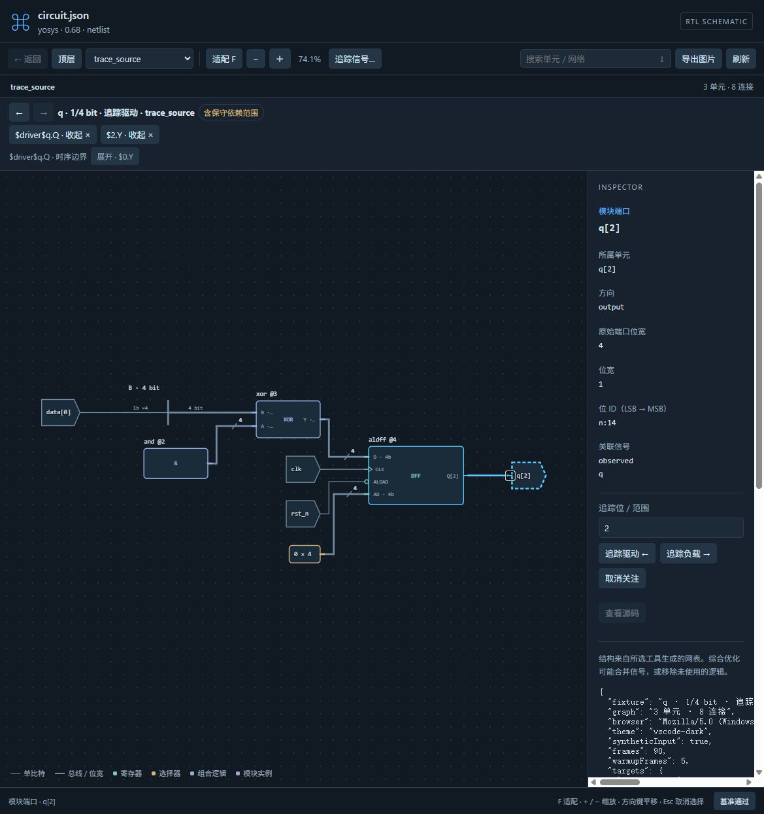
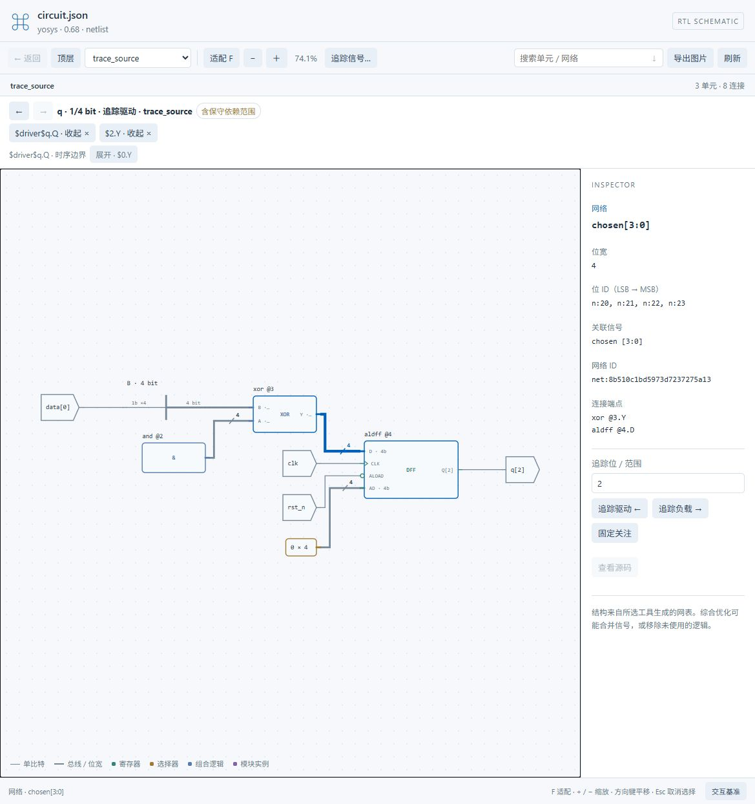

# 4.1 M3：容量、交互与预览安装包验收

日期：2026-10-25。分支：`codex/feat-v4.1-signal-tracing`。版本：`4.1.0-beta.3`。正式稳定版仍为4.0.0；本轮准备本地预览，不发布GitHub Release或Marketplace。

当前阶段：源码回归、公开压力夹具及实际浏览器检查通过，安装包解包验收执行后补充最终结论。

## 本轮修复

- 高扇出在端点入队前检查单元预算；未知/双向端点使用同一规则。达到预算保留部分结果和真实网络总扇出，不提高硬上限。
- 展开栏新增/删除行时，先更新控件再测量画布；相机补偿图锚点和页面位置差值。实际28像素偏移已消除到该页面1像素几何取整范围。
- 容量原因显示中文说明，保留原始协议原因供自动验收，不把内部对象ID作为界面提示。
- 捕获新编译快照时清除旧观察器在刷新期间留下的过期标记，避免模型定位成功但界面仍禁用源码跳转。beta.1候选因此不交付，保留用于复盘。
- 共享源码清单失效后最多重读一次，持续变化时明确报告；不再将清单世代变化误报成4096文件超限，生成目录和无关主题设置也不触发失效。beta.2因此未作为最终交付包。
- 局部常量符号保留实际常量值详情；没有真实来源映射的展示对象不能作为虚构模型起点发起追踪。
- JS、Rust、native及CLI同步4.1.0-beta.3；公开包继续排除私有ModelSim目录和入口。

排查记录：[高扇出预算](bugs/perf-circuit-trace-fanout-budget.md)、[屏幕锚点](bugs/logic-circuit-trace-screen-anchor.md)、[刷新来源状态](bugs/logic-circuit-refresh-source-stale.md)、[清单失效与容量误报](bugs/logic-source-catalog-invalidation-budget.md)。操作方式沿用[M2指南](V4_1_M2.md)。

## 真实工具与公开夹具

`test/fixtures/circuit-trace-stress.sv`由内置Yosys/Slang实际编译：

| 场景 | 核对内容 |
|---|---|
| 768个独立AND负载 | 截断后128单元、131节点、257连线可布局，明确单元预算；纯模型另核对真实3,000扇出 |
| 两个参数化寄存器实例 | 使用工具实际专用模块ID与端口位置，时序边界需显式跨越 |
| 两个时钟域 | 保留各自实例和工具确认的控制端点，不合并同名时钟 |
| 升序总线、重排、复制和常量 | 保留声明下标及独立常量归属 |
| 写入及异步读取存储器 | 保持存储器边界，不将其猜成普通组合单元 |

源码和4.0回归：golden44/44；Node686通过、1项官方标准目录重建可选跳过（未提供上游完整语料）；beta.1电路218/218，beta.2另加入刷新交接回归，最终安装包检查记录219项。启用了本机Icarus实际编译/仿真及Qoder TextMate，而非跳过这些环境检查。原生模块和CLI使用已有离线依赖构建。

复验：`npm test`，`node --test test/circuit_trace_capacity_test.js test/circuit_trace_stress_native_test.js`。启用Icarus/TextMate的环境变量见对应测试源码。测试源只使用公开夹具和隔离工作区，没有写用户RTL。

## 实际浏览器交互

使用内置浏览器Chrome156打开正式页面、真实Worker与ELK；开发SSE桥只替代VS Code消息传输。逐项检查了选定位、显式时序展开、收起/历史、关注恢复、鼠标拖动、搜索、总线高亮及明暗主题。亮色选中线条实际为`rgb(0, 95, 184)`且不透明，能与背景区分。

交互基准通过页面的开发按钮触发，合成事件走正式监听器；它与上述真实鼠标/键盘检查分开记录。每个阶段90帧，排除前5帧；预设目标为处理器P95≤8ms、帧间隔P95≤40ms。使用本机常规开发环境，未进行专用性能机器隔离，也不作任意设计60fps承诺。

| 页面 | 活动SVG元素 | 拖动/缩放/选择处理器P95 | 帧间隔P95 |
|---|---:|---|---|
| 小型局部图，暗色 | 163 | 0.3 / 0.2 / 0.6ms | 约16.7–16.8ms |
| 小型局部图，亮色 | 163 | 0.2 / 0.2 / 0.6ms | 约16.8ms |
| 128单元压力图，2.8%总览 | 3,495 | 0.2 / 0.2 / 0.7ms | 约16.7–16.8ms |
| 128单元压力图，60%局部视口 | 625 | 0.2 / 0.2 / 0.8ms | 约16.8ms |

测量记录位于`bin/circuit-trace-m3-browser/`和`bin/circuit-trace-m3-dense-browser/`。正式客户端仍按可见范围裁剪，正常倍率数据不代表同时绘制所有节点。

复验入口：`node scripts/preview-circuit.js --json <真实网表.json> --measure --out <记录目录>`，从页面选择信号进入局部图后点击“交互基准”。本地测量脚本与按钮不进入扩展安装包。

## 发布边界

本预览交付P0的源码、局部图、连续导航与受验证源码定位。波形实例映射、A/B游标值叠加属于M4。原有[M2限制](V4_1_M2.md#已知限制与下一阶段)仍适用，包括证据不足的成员/generate/条件编译、缺少来源快照的导入网表、include快照覆盖及非跨IDE重启的历史。

已知复杂依赖只返回保守范围；容量截断明确保留部分结果，取消不承诺立即终止ELK内部计算。Vivado仍使用其实际平坦模型，不推测层级或未知引脚语义。

安装包的来源提交、SHA256、公开排除检查和解包宿主结果记录在本轮本地交付清单；4.1正式发布仍需用户确认预览使用结果。
