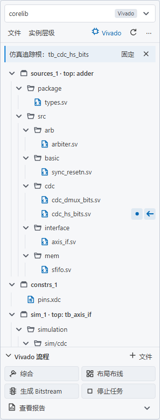
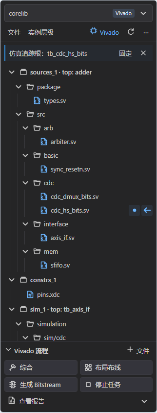

# 4.1 统一工程管理与多层级信号走向

活动栏保留一个 **SV Tools 工程** 入口。顶部切换器统一列出 Vivado 与 SV Tools 工程，来源由标签区分；视图下方切换文件和实例层级。

## 使用

1. 打开工作区，在工程切换器中选择已有 `.xpr`，或者创建 SV Tools 工程。
2. SV Tools 工程保存到工作区 `.svtools/projects/<名称>.json`。资源管理器右键 HDL 文件或文件夹，选择“添加到 SV Tools 工程…”。文件夹采用目录跟随，忽略工具生成目录和目录链接；文件保留原始路径。
3. 文件右键可设置工程顶层、仿真顶层、移动到设计／仿真集，以及移出工程。移出不删除磁盘文件。Vivado 工程仍通过原有 Tcl 执行管理操作和综合／实现／报告。
4. 保存参与分析的源码，在 RTL 编辑器中选中信号，默认约300ms后自动追踪；不需要先执行一次右键命令。使用独立Worker逐文件做静态RTL连接分析，无需Yosys/Vivado，不运行综合、不创建临时网表。自动模式不会抢焦点或弹出进度通知，提示显示在工程侧边栏。
5. 文件或模块实例名称右侧显示角色：`●` 为所选内部声明位置，`→` 为输出，`←` 为输入，`↔` 为双向，`?` 为未知方向。标记可组合，信号名、端口和位下标放在悬停提示里。
6. “实例层级”区分同模块的不同实例；“文件”聚合同文件实例的角色。点击实际实例回到经快照校验的源码位置。
7. 选择其它信号复用静态模型更新标记，连续快速选择只发布最后一次结果。多个实例无法唯一选择时，使用右键“在工程中追踪所选信号”明确实例上下文。“固定”保留当前追踪；源码修改、工程成员或顶层变化仍撤销过期标记，已读取的字面头文件也被监视。

工程“⋯”操作菜单可切换自动／手动追踪；也可设置 `svtools.project.traceTrigger` 为 `selection`（默认）或 `manual`。手动模式仅运行右键或工程菜单中的追踪命令。

Vivado工程顶部显示“Vivado”入口，文件树下方的流程区提供综合、布局布线、生成Bitstream、停止任务，以及综合／资源／时序报告。“＋ 文件”用于添加文件到当前Vivado工程；自管理工程仍在顶部显示“添加”。流程区可以收起，顶部入口可重新展开；展开状态按工程记忆。文件夹名称和三角形均可展开／收起，文件与实例标签仍用于源码定位。

底部静态分析说明默认隐藏；在“⋯ → 查看分析提示”中按需展开，实际错误仍在状态区显示。下图是使用实际Webview模板、脚本与样式渲染的示例工程预览。

| 亮色 | 暗色 |
|---|---|
|  |  |

追踪根按所选文件确定：仿真集文件优先使用相应仿真顶层，设计集文件优先使用综合顶层。若配置顶层的静态实例树不包含所选模块，则以所选模块为根；侧边栏显示实际追踪根。这不会修改工程综合／仿真top。仅能上溯到当前追踪根；未知位宽或条件分支仍提示边界，不通过换根掩盖解析限制。

切换工程不改变原 Vivado top，不中断已有 Vivado 运行。展开状态和文件／实例显示方式按工程记忆。工程切换会释放追踪 Worker 并清除旧标记，返回工程后重新发起追踪；不把过往结果当作有效的新工程连接。

## 多层透传

追踪依次在模块局部网络和父子端口边界之间映射，支持上溯父级、进入兄弟实例、继续下探子模块。支持已知参数默认值/覆盖、整数算术和`$clog2`、端口改名、HDL升降序、切片/拼接/复制、非ANSI顺序端口、隐式命名和`.*`连接。位关系由可确定的声明范围和表达式建立，不以信号同名或文件路径作为跨模块连接证据。

例如 `top.u_a.rx → top.u_a.u_leaf.data`，以及叶模块输出改名回到父模块 `tx`，均能在同一次追踪中呈现。另一份 `top.u_b` 只有在实际连接到相同网络时才会标记。

这是一条信号的**网络连接与端口透传**。它不会自动穿越反相器、组合逻辑、寄存器或黑盒去猜测另一条信号；常量不按数值合并。已知多驱动、潜在条件驱动和未解析实例连接会阻止不安全的连续别名合并。双向、未知方向有明确提示，箭头表示端口声明方向，不表示仿真时的实际驱动方向。

尚未执行追踪时，实例页沿用有界源码引用预览；执行后显示静态连接中可确定的实例。普通宏不执行展开，条件/生成块、实例数组、多维打包/非打包范围和未知用户类型尚未进行完整详细化，会提示边界；未知范围不会退化成单比特，也不会改变顺序端口的位置。该模式不能当作完整SystemVerilog elaboration或网表等价证明。Vivado工程操作、Yosys/Vivado电路生成入口继续保留。

## 配置

```json
{
  "schemaVersion": 1,
  "name": "corelib",
  "root": "../..",
  "sources": ["src/top.sv"],
  "simulation": ["sim/tb_top.sv"],
  "folders": [{"path": "src/blocks", "fileset": "sources"}],
  "exclude": [],
  "top": "top",
  "simTop": "tb_top",
  "includeDirs": ["include"],
  "defines": ["SYNTHESIS"]
}
```

`root` 相对于配置文件目录，其余路径相对于 `root`。`sources` 与 `simulation` 是明确成员，优先于目录跟随中的排除；移动目录跟随的单个文件到仿真集时，会保存排除和新的明确成员。工程成员经共享源码服务提供给补全和现有工具链。`includeDirs`用于查找字面头文件；`defines`保留为上下文，当前静态模式不进行普通宏展开，涉及宏的连接保持不确定边界。现有各工具自身的配置仍保留。

## 预算与验收

工程最多4096个HDL文件，目录扫描最多50000项／32层。静态输入（含头文件）最多4096项／16MiB，单文件2MiB，索引500000个token、512种参数化模块和250000个声明位。实例快照最多3000项／64层，单次连接查询最多100000次访问；超限明确标注结果不完整或要求缩小工程。页面最多同时展示1500个展开节点，保持有界DOM。

静态后端回归覆盖独立时间声明、无关不可综合模块、参数范围、多层位映射、条件边界、头文件与旧世代拒绝。隔离VS Code/Qoder宿主将Yosys路径设为不存在，验证工程追踪、模型跟随/固定及源码失效，且没有创建网表或工具任务目录。它们不等同于人工鼠标和明暗主题视觉验收。

历史Local.11验收：语法检查273个文件；golden44项；Node731项通过、12项可选测试跳过；电路227项全部通过。Local工具链检查22项通过、5项可选检查跳过；此包仍使用Yosys工程追踪。

无Yosys追踪使用`4.1.0-beta.4-local.13`，保留自用ModelSim。最终回归：语法277个文件，golden44项；Node744通过／12跳过；电路227全部通过；Local检查22通过／5跳过。新增静态后端13项测试已纳入Node回归。

追踪根修复与默认自动模式使用`4.1.0-beta.4-local.15`。回归：语法280个文件、golden44项；Node754通过／12项可选跳过；电路227通过；Local检查22通过／5项可选跳过。最终包在隔离VS Code1.143.0与Qoder API1.106.3宿主各通过11项，包括首次自动追踪、手动模式、模型复用、TB上下文、连续选择和工程切换。只读验证实际`tb_cdc_hs_bits.sv`中的5个信号（时钟、复位、8位输入／输出及内部寄存器），未改用户RTL或工程top。生成块／宏／未知类型限制仍保留。

新版工程面板使用`4.1.0-beta.4-local.16`。回归：语法281个文件、golden44项；Node757通过／12项可选跳过；电路227通过；Local检查22通过／5项可选跳过。最终包的VS Code／Qoder宿主各11项通过。真实浏览器另检验320px亮暗主题、240px窄面板、自管理工程切换、报告菜单锚定／Esc、文件夹名称展开和按需分析提示，无脚本／CSP错误及横向溢出；截图使用示例工程，不代表已运行Vivado综合。

实际包staging在VS Code1.143.0和Qoder API1.106.3各通过8项宿主验收，均将Yosys路径设为不存在并确认没有网表任务目录。归档503项载荷逐字节核对一致，149个src运行脚本与源码一致；README／CHANGELOG为vsce正常链接转换。另对含sfifo的12个用户工程源文件只读验证，全部源码字节哈希前后不变。未进行人工鼠标／明暗主题视觉验收。

修改文件与职责见 [V4_1_PROJECT_MANAGER_FILES.md](V4_1_PROJECT_MANAGER_FILES.md)。
