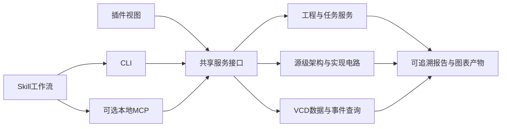

# SV Tools 4.2：Agent工程工作台

更新日期：2026-10-31。

状态：M1 已提供开发态的无界面工程查询、格式化、Icarus 检查和后台任务接口，见 [CLI 使用说明](CLI.md)；后续能力仍为计划。CLI 的结果合同版本为 API 1，4.2 尚未发行。

## 目标与现有基础

让Agent通过CLI、Skill或本地MCP完成FPGA工程搭建、架构表达、RTL仿真调试、实现分析及技术报告产物生成。插件继续提供同一份数据的交互视图。

现有基础包括独立Rust格式化CLI、任务取消与日志、Vivado工程创建/运行/报告脚本、独立电路模型及ELK/SVG、VCD解析/查询及图像导出。当前Vivado已有分层资源、逻辑级数及实现时序汇总入口；丰富的结构化报告接口仍需开发。工具执行与数据服务仍有工程、配置、文档和UI依赖需要拆开，4.2按共同服务合同完成适配。

首发仍只维护Windows x64。能力发现只公布当前发行物实际包含的工具链；保留原有CLI格式化用法和非排版字符守恒约束。

## 架构与职责

- 服务层处理明确的数据、配置、文件与进程边界；编辑器适配层负责活动文档、状态栏、弹窗及Webview。
- CLI提供可复现命令和纯JSON输出；日志独立保存。MCP作为同一服务的可选薄适配层，不作为4.2首发门槛；需要时优先采用本地stdio，并按目标客户端验证协议兼容性。
- Skill描述如何选择工具、解决上下文歧义、判断失败、组合查询和复验。Agent负责设计决策、修复策略及叙述，服务返回工程事实、执行结果和可验证产物。
- 格式化和代码生成沿用Rust核心；工具链编排、电路及波形服务按现有模块拆出，不在各入口复制业务实现。

## 共同上下文与结果合同

每次操作绑定明确的工程/工作区、器件、源文件集合、综合或仿真fileset、top、实例路径、宏、include目录和参数。存在多种合法上下文时返回候选及原因，由调用者提供选择。无界面操作不依赖当前编辑器选中的文件。

结果采用版本化结构，包含操作状态、上下文身份、诊断、摘要、产物、分析边界及适用的任务ID。每份产物关联源码版本、工具版本、生成阶段和实际run；源码或VCD变化后旧映射和分析结果明确失效。

长任务提供启动、状态、进度、日志及取消入口，保留独立工作目录、并发上限和超时。插件、CLI与MCP并发运行时，工程写入与波形产物采用跨进程占用协调，保护正在读取的VCD和进行中的Vivado运行。

文件修改提供变更差异；格式化默认可检查或返回diff，写入通过显式选项表达。工程运行失败、报告缺失、不支持的报告或尚未达到的分析阶段都有明确结果，缺失数据不会表示为零错误。大图和大数据返回有界摘要、分页/截断信息及产物引用。

## A：Vivado工程管理与报告驱动调试

### 工程与运行

1. 创建、打开、检查工程，查询本机Vivado版本及有效器件，管理源文件、库、include、宏和XDC。
2. 明确管理综合top与仿真top、fileset及编译顺序；加入/移除工程引用与删除物理源文件分别表达。
3. 查询已存在IP和依赖，沿用项目实际文件及属性；IP Catalog新建、参数配置和升级继续作为独立后续能力，不隐含在首批工程管理中。
4. 启动详细化、仿真、综合、实现和Bitstream生成，查询状态、停止任务并取得本轮日志/产物。工程变更支持幂等应用和前后配置差异，恢复或重试不会重复加入文件。

### 结构化报告

| 报告族 | Agent可取得的事实 | 关键上下文 |
|---|---|---|
| 时序汇总 | WNS/TNS、WHS/THS、失败端点、未约束情况 | 综合/布局/布线阶段与时钟约束 |
| 关键路径 | 起终点、时钟、slack、逻辑/连线延迟及路径单元 | 真实实例/引脚身份，映射可确认程度 |
| 资源 | LUT、FF、BRAM/URAM、DSP等器件资源和层级分布 | 器件、run、统计阶段 |
| DRC | 规则ID、严重级别、相关对象及原始描述 | 适用规则集与运行阶段 |
| CDC/时钟 | 跨域路径、规则、源/目的时钟及可取得的时钟关系 | 分析范围、已识别时钟及约束 |
| 运行消息 | 编译错误、警告、关键警告、源码位置和run失败阶段 | 完整日志及来源映射 |

优先通过Vivado Tcl对象和属性读取可结构化的数据，报告文件始终保留。需要文本解析的部分按工具版本适配并报告解析边界。综合估算与布线后结果明确区分；不具备条件的报告返回所需阶段/输入信息。

Agent调试流程为：读取状态与报告 → 定位层级、路径、源码或约束 → 应用有依据的修改 → 重跑相应步骤 → 比较两轮报告和功能验证。约束修改需说明设计依据，并复核约束覆盖、未约束路径和CDC；时序结论附分析阶段。每轮保留源码/配置差异及对应结果，支持设置迭代和总耗时预算。

后续按需求加入功耗、拥塞、扇出等报告；功耗结果同时记录活动数据及估算假设。真实工具验收按用户实际Vivado版本执行，官方最新文档中的命令/字段不自动视为本机可用。

## B：以空模块组织架构设计

以RTL模块接口、参数及顶层例化连接作为架构事实。Agent可先生成只有接口的模块骨架，再组织顶层连接，查看和检查整体架构，逐个补充实现。

架构视图采用源级模型，保留空模块和待实现单元；宏、生成结构和参数需要可靠展开时复用或引入相应前端适配，无法解析的部分显式标记。未确定的位宽保留原表达式和未知状态，模型扩展不得以虚构的已知位数补齐。优化后的Yosys/Vivado网表继续用于实现电路视图，两者共用可扩展的身份、层级及渲染基础，并保留不同的来源和阶段。

首批能力：

- 模块、层级、实例、端口、方向、位宽、参数及连接查询；明确标注待实现、外部黑盒和未知部分。
- 结构检查：缺失模块/端口、重复实例、连接遗漏、多驱动、位宽不一致及隐式截断/扩展。按语言实际语义报告，允许的扩展不一律当语法错误。
- 时钟/复位域和接口分组来自明确标注或已解析事实，未确定的角色保持未知。
- 生成总体框图、分层模块图和接口表；保留源码位置，支持从架构单元进入已实现模块的电路。
- 逐步补实现后比较接口/层级变化，保留模块身份和可用的人工布局。结构检查结果与功能、时序验证分别记录；空模块明确标为待实现。

连接设计通过RTL变更体现；图上拖动调整布局。Vivado Block Design自动编辑和通用图形编辑回写RTL可作为后续独立增强评估。

## C：面向技术报告的图表与证据包

Agent能够按目的选取图表及结构化事实，再组织设计说明、调试分析和验证报告。

图表包括源级架构总览、模块接口、局部实现电路、信号逻辑锥、可确认映射的关键时序路径，以及指定信号/时间窗的波形。图片支持现有的黑白技术文档风格和界面风格，提供SVG与PNG；导出服务从数据/布局生成，支持无编辑器运行。

每个报告包至少包含：

1. 图表文件及可复现的导出参数。
2. 机器可读的接口、连接、时序/资源/验证摘要，原始报告和日志引用。
3. Markdown图注/表格草稿与证据索引。
4. 工程、top/实例、源码版本、工具版本、run/仿真身份、分析阶段、波形时间范围及已知边界。

架构草图、RTL电路和实现后分析在图注中标明阶段。服务根据真实数据生成统计及图表，Agent根据引用撰写解释；报告中的数值和结论可追溯到证据。Word/PDF等成文由调用端的文档流程消费同一产物包，首批交付以SVG/PNG/JSON/Markdown为主。

## D：以波形查询提升RTL调试能力

### 数据与事件查询

- 按层级、方向、位宽和可取得的源码角色查找信号，支持总线、逐位、现有浮点解码及二维mem观察能力。
- 查询指定时间点、A/B差异、时间窗、跳变、上升/下降沿和X/Z，保持原始位值与精确时标。
- 按指定时钟采样，以受限的结构化条件查找首个异常、脉冲宽度、持续条件或握手停滞；上下文和条件明确，返回命中时刻与附近数据。
- 从可解析的仿真失败日志或调用者提供的错误时刻取得前后窗口，导出包含相关信号的波形图。

JSON中的精确时间采用整数tick字符串及timescale/单位表达；原始位值、X/Z状态和格式化/浮点解码值分别提供，避免浮点序列化丢失fs精度或未知位信息。

### 调试流程

仿真失败 → 取得本轮日志/断言或参考模型给出的失败时刻 → 查询关键周期和信号 → 在已确认的DUT实例映射下联动源码、驱动/负载和局部电路 → 修改RTL → 再仿真并对比相同检查条件。

首次数据不一致、复位释放后的X、valid/ready停滞、FIFO读写顺序等作为首批可复现案例。协议检查使用指定的时钟和握手信号；期望数据来自明确的TB、参考模型或规则。CDC静态报告、功能仿真和波形观察保留各自验证范围。

沿用100–500MB VCD目标，避免把完整波形送入模型。查询有信号/时间范围、分页或截断边界；长会话通过数据句柄复用索引，CLI支持批量查询以减少重复打开。记录首次索引时间、连续查询延迟、读取工作量和内存峰值，基准后决定进一步缓存策略。

VCD与源码/电路的实例和位映射须有可验证依据；歧义返回候选，源码/波形改变后失效。失败仿真不把旧VCD或不完整产物当作本轮成功数据。

## 建议实施顺序与验收门槛

| 里程碑 | 交付 | 验收 |
|---|---|---|
| 4.2-M1 | 共享工程上下文、任务/数据身份、配置与结果合同；无界面服务；CLI基础适配及Skill使用入口 | 关闭IDE可运行基础能力；JSON稳定；保留旧CLI；取消、并发、版本失效和错误语义有回归 |
| 4.2-M2 | Vivado工程/运行/结构化报告；CLI+Skill预览 | 隔离真实工程完成创建、加入源/XDC、设置两种top、运行、定位故障、修改和报告对比；缺报告/缺阶段/工具占用明确 |
| 4.2-M3 | 源级架构模型、空模块骨架、结构检查和报告图表包 | 参数化空模块在图中保留；补实现后可比较；位宽和遗漏连接样例被准确指出；SVG/PNG与数据出处一致 |
| 4.2-M4 | VCD查询、事件搜索、时间窗导出及源码/电路联动 | 已知RTL缺陷定位到首个错误窗口并复验；100/500MB代表样本验证资源边界、精确值与索引复用 |
| 4.2-M5 | Skill工作流、CLI/插件联合验收与发行；按需验证MCP适配 | 完成以下端到端场景，记录目标客户端兼容性；能力发现与发行文件检查通过 |

端到端场景：

1. **从架构到工程**：用空模块组织参数化FIFO及周边模块，导出架构和接口表，补充实现/TB并搭建真实Vivado工程。
2. **从失败到修复**：注入已知RTL错误，运行仿真，利用波形找到首次不一致并沿驱动关系定位源码，修改后用同一规则复验。
3. **从报告到优化**：读取真实资源/时序及可用DRC/CDC结果，定位目标路径/层级，记录并复验一次有依据的变更。改善指标与功能结果同时保留。
4. **从工程到文档**：生成包含架构、接口、局部电路、失败/修复波形、实现报告摘要和证据出处的报告包，Agent无需启动IDE即可消费；插件打开相同产物应一致。

这些条目是4.2计划，不表示4.1已经具备全部无界面接口；FSDB维持此前取消的决定。

## 技术依据

- [MCP工具与结构化结果](https://modelcontextprotocol.io/specification/latest/server/tools)、[标准传输](https://modelcontextprotocol.io/specification/latest/basic/transports)。协议实现版本以目标客户端实测兼容矩阵为准。
- [Agent Skills格式](https://agentskills.io/specification)。
- [Vivado时序汇总](https://docs.amd.com/r/en-US/ug835-vivado-tcl-commands/report_timing_summary)、[路径对象查询](https://docs.amd.com/r/en-US/ug835-vivado-tcl-commands/get_timing_paths)。
- [Vivado DRC报告](https://docs.amd.com/r/en-US/ug835-vivado-tcl-commands/report_drc)、[CDC报告](https://docs.amd.com/r/en-US/ug835-vivado-tcl-commands/report_cdc)。
