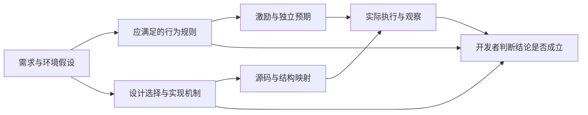

# SV Tools 4.3 · 看懂设计原理与验证逻辑

## 核心目标

让开发者快速建立正确的设计理解，能够判断模块为什么满足需求，以及验证用例为什么足以支持某一条结论。4.3 的主要交付是可交互的设计说明与验证讲解，把设计意图、实现机制、预期行为和实际观察放在同一条阅读路径上。

开发者打开一个陌生模块后，应能回答以下问题。

1. 它解决什么问题，在什么输入、时钟、复位和环境条件下工作？
2. 数据怎样流动，控制如何决策，为什么采用这种结构？
3. 正确运行必须满足哪些规则，这些规则由哪些设计机制保证？
4. 用例为什么选这些激励，期望结果如何推导，什么错误会让它失败？
5. 当前观察支持哪些结论，还有哪些条件和行为没有验证？

设计依据和验证期望共同来自需求。实现可以帮助解释机制、定位问题，但不能把当前实现行为直接当成正确答案。需求中未确定的复位语义、异常处理或时序条件应作为显式假设呈现，供开发者判断。

## 基本组织方式

最小审阅单元是一条能被判断的设计结论，例如「背压期间待发送数据保持不变」「复位后不会读出复位前的数据」。每条结论组织以下内容。

| 阅读层次 | 要回答的问题 | 呈现方式 |
| --- | --- | --- |
| 功能约定 | 什么条件下，应该发生什么？ | 简明行为规则、输入输出、前提和例外，附一个可手算的小例子 |
| 设计机制 | 为什么这样实现能满足约定？ | 有语义的数据通路、控制条件、状态变化、时钟与复位边界，解释关键选择和取舍 |
| 关键性质 | 哪些关系必须始终成立，或在限定条件下最终成立？ | 自然语言规则与对应表达式并排，明确采样时刻、适用范围和关联实现 |
| 用例推导 | 怎样有针对性地检验这条规则？ | 初始状态、合法激励、边界选择、预期推导、观察点和失败条件 |
| 实际观察 | 这次运行是否真的触发并检查了它？ | 预期与实际并排、关键事件回放、检查执行情况及尚未覆盖的条件 |

同一个规则贯穿说明、图示、代码和用例。开发者选择一条规则时，相关内容一起聚焦，保持模块实例、参数和时间位置一致。

## 如何呈现设计原理

### 先建立整体理解，再展开局部机制

工程首页以主要功能和典型数据流组织阅读。例如从「接收数据 → 缓冲 → 运算 → 输出」理解模块分工，再进入某个模块的工作方式。连接线上表达数据含义、传输条件和时钟域，端口位宽等细节按需展开。

模块说明先给出职责、接口约定和一个最小工作例子，再解释决定正确性的少数机制。按设计特点选择数据通路、状态机、算法步骤、流水线时序或跨域示意图。解释为什么需要某个寄存器、状态、仲裁策略或复位处理，并指出相应的延迟、吞吐和资源取舍。

复杂模块按行为分组，例如正常传输、背压、复位恢复、溢出处理。每组显示有关状态和信号，保留与整体架构的关系。源级结构、实现后的电路和用于讲解的功能示意图标明各自含义。

### 用事件回放解释变化原因

选中典型场景后，按有意义的事件前进，例如「接受一个输入」「进入等待」「解除背压」「复位释放」。每一步同时展示事件前后状态、触发条件、被选择的数据路径及输出变化；多时钟场景标明所属时钟和采样沿。

说明中的「此时保持数据，因为接收方尚未接受」应能定位到相应使能条件、寄存器和真实信号值。支持查看该时刻附近的源码与波形，失败时停在首次偏离预期的位置。通过场景也需要有可讲清楚的代表性回放。

教学示例与真实运行分别标识。缺少内部信号记录时，只展示已有观察；不能把推测的内部状态画成实测结果。首版允许 Agent 提供语义说明和映射，工具校验目标存在、实例匹配及数据来源，不承诺从任意 RTL 自动推出完整设计意图。

## 如何让开发者判断用例是否正确

每个代表性用例提供一段可检查的推导。

| 环节 | 开发者应能检查的内容 |
| --- | --- |
| 目的 | 针对哪条需求、哪种边界或可能的错误；为什么需要这个场景 |
| 前置条件与激励 | 初始状态怎样建立，激励是否符合接口约定，时钟相位、参数和复位宽度为什么这样选 |
| 独立预期 | 从需求或参考算法推导期望，用小规模数据展示计算步骤；说明参考模型简化了什么 |
| 检查方法 | 在哪个事件或采样时刻检查哪些值，允许什么延迟，何时判失败，超时怎样处理 |
| 实际触发 | 本轮是否达到目标状态、触发断言前提并执行比较；未触发与检查通过分别显示 |
| 判错能力 | 一个有代表性的错误设计或错误输出会在哪一步被发现，实际注错结果与推演示例分别标识 |
| 范围 | 已检查的参数与场景组合，依赖的环境假设，仍未检查的组合 |

验证说明还要帮助发现测试本身的问题，例如参考模型照抄了 DUT 的同一个错误、比较发生在错误采样时刻、关键比较被关闭、断言前提始终不成立。独立性说明应具体到预期计算过程；仅标注「独立验证 Agent」不能替代这项检查。

用例的预期视图可以在揭示实际结果前阅读，让开发者先推导应该看到什么，再与运行对照。对适用的关键规则，提供正常与故障场景对照，说明检查如何区分两者。注入一个故障被抓到，只支持该故障类别的判错能力；仍需单列覆盖范围。

## 设计与验证讲解示例

使用已有 [M5 FIFO 验证记录](V4_2_M5_FIFO_VALIDATION.md) 中的复位场景说明一条完整阅读路径。其设计、TB 和故障注入位于 [验证脚本](../scripts/verify-fifo-workflow.cjs)。以下描述是原型应呈现的内容，运行结果沿用历史记录，本次规划未重新仿真。

**设计约定**：这个试点的单侧复位会联动两个时钟域，丢弃在途数据；恢复后、没有新写入时不得发生有效读取。这个约定限定于该试点，其他 FIFO 的复位语义需要各自定义。

**设计机制**：局部图聚焦读指针、同步到读域的写指针、空标志和读请求。解释空标志如何由指针关系产生，以及这些状态为什么必须在复位后保持一致。

**故障机理**：历史注错版本遗漏同步链复位。读指针已经清零时，同步链仍可能保留旧写指针，导致假非空。图示逐步呈现「旧同步值 → 假非空 → 读请求被错误接受」。

**用例推导**：先制造同步链中的非零历史状态，再施加短于链条自然冲刷时间的复位，并持续保持读请求。这样释放复位后的危险窗口会被实际访问。说明长复位为什么可能掩盖缺陷，以及临时撤掉读请求为什么可能错过错误读取。

**预期与检查**：按复位丢弃在途数据的约定，参考队列清空；没有新写入时，队列没有可读数据。开发者能看到这个预期如何得出，以及空标志、读接受事件和队列检查分别承担什么作用。已有脚本借用 DUT 内部复位信号安排部分检查，原型应明确展示这项依赖，不能把它描述成完全独立的复位验证。

**实际对照**：展示历史注错运行中的 `PHANTOM_READ`、`DATA_MISMATCH` 和修复后同一用例的结果。读者先理解为什么会错，再看到检查在哪个时刻发现它。详细波形中未记录的内部状态不自动补成实际值。

## 面向复杂工程的阅读方式

- **按功能逐层展开**。从系统任务和数据流进入模块，再进入某条行为规则，最后查看代码、检查器和波形。保持当前问题与所在层级可见。
- **显示模块之间的约定**。对连接两端并列呈现数据格式、传输条件、延迟、背压和复位语义，指出上游保证是否满足下游假设。选择一个跨模块事务，追踪它经过各阶段时的数据和状态变化。
- **从局部结论走向系统行为**。模块通过测试后，还需要解释组合后的顺序、吞吐、阻塞和恢复行为依赖什么条件。系统用例展示这些条件怎样被触发和观察。
- **围绕疑点审阅**。支持从「为什么需要这个状态」「为什么该周期允许读取」「这个用例能抓什么错误」进入相应机制和用例。关键解释预先保存在交付内容中，问答用于进一步探索。
- **按理解影响展示变更**。比较版本时说明哪项接口约定、设计机制或关键性质改变，以及哪些用例的激励和预期需要随之调整。

## 产品与实现边界

建议提供「设计讲解」入口。阅读区呈现当前规则及推导，主视图区展示相关结构或事件过程，验证区展示激励、预期和实际。选择规则或时间步骤时各区联动，窄窗口按阅读顺序排列。首屏优先给出模块做什么、如何工作和需要理解的关键问题。

原型入口与清单格式见 [设计讲解使用说明](DESIGN_REVIEW.md)。

首轮先实现三步交互。

1. 从一条待判断的行为进入。首屏给出该行为的适用条件和关键机制，保留当前模块、候选与验证场景，支持沿原路径返回。
2. 选择一个事件。局部结构、状态或地址、对应源码和用例采样点一起聚焦。读者可先推导期望，再展开实际结果；对照两个候选时按同一事务事件对齐。
3. 核对结论的支持范围。并排显示哪些条件已触发、检查了什么、首次偏离在哪里；用例通过与目标场景未触发分别显示。

原型验收用两条路径起步，一条解释跨模块数据通路上的真实缺陷，另一条解释协议用例通过但预期时序未触发。先用现有工具采集对照基线，比较做出正确且有依据的判断所需的时间，以及误把证据不足判为通过的比例。根据这轮结果完善交互，再扩充组件类型与项目范围。

4.2 已有架构与报告、[电路和波形联动](WAVE_LINKS.md) 及 [交付说明约定](../skills/svtools-delivery/references/delivery.md)，可以复用。当前 [设计进展](../src/project/progress.js) 提供模块状态和文件引用；4.3 需要增加从设计含义到验证推导的阅读组织。

在已有说明与证据索引上补充结构化关联，让规则、机制、用例、预期步骤、源码锚点和运行事件有稳定标识。Agent 编写设计解释和验证推导，工具提供结构提取、映射校验与实际数据读取，开发者据此审阅。先用两条真实场景验证阅读交互，再确定公共数据格式和通用接口。

解释中分别呈现需求约定、工具提取事实、Agent 推断和运行观察。发现需求含糊、解释与代码不一致或用例预期不成立时，保留具体疑点。现有候选身份、失效检查、运行来源和原始证据链接作为配套能力，保证读者看到的解释适用于当前设计。

## 实施顺序与验收

| 阶段 | 主要交付 | 验收方式 |
| --- | --- | --- |
| M1 · 前端交互原型 | 先完成数据通路缺陷与协议验证缺口两条审阅路径。把规则、结构、用例推导及实际观察放在同一交互中 | 以 4.2 现有方式为基线，开发者能更快说清设计为什么成立或失效、验证实际检验了什么，且不增加误放行 |
| M2 · 原理与验证联动 | 将规则、源码、结构、事件与检查器关联，支持数据通路和状态控制两类代表性模块 | 切换规则或事件后各视图保持同一上下文；解释与源码不符、用例未触发和预期有错时能呈现差异 |
| M3 · 多模块理解 | 增加功能层次、接口约定对照、跨模块事务回放和变更解释 | 开发者能指出上下游假设不一致的位置，解释一个事务如何完成及阻塞、复位后如何恢复 |
| M4 · 理解效果验收 | 用真实工程进行开发者盲审，对比现有文档和工具的阅读方式 | 记录理解耗时、回答准确性、设计错误和验证错误的发现情况，按试点结果确定发布门槛 |

盲审任务覆盖正常设计、已知设计缺陷、错误期望、关键检查未触发和模块接口假设不一致。错误变体分别准备可复现的对照依据，避免把主观评价当成正确性标准。

核心验收是开发者能在看实际结果前推导期望、读后解释关键设计选择，并发现设计或验证逻辑中的问题。定位时间与操作步数用于评估交互效率。4.3 的功能取舍优先服务这组目标；IP/BD 等候选能力按试点中理解工程的实际需要安排。

## 试点现状

- I²C 时钟拉伸验证了从 Note 打开定版、定位测试台和读取波形的工作流。
- `06_modules` 的 `conv3x3` 用历史 RTL 和同一份独立探针复跑了满宽帧缺陷。复核页显示接口两端的地址条件、有效输出异常和修复前后的源码差异。
- FIFO 短复位使用 `node scripts/verify-fifo-workflow.cjs --review` 复跑。输出保留注错版、修复版的独立 VCD、可复核 Note、主题导出和题面。

人工验收先提交依据需求推导的地址、指针或输出值，再分别用原资料和 4.3 复核页定位证据。交换入口时换一道题，分别记录推导时间、定位时间、操作数、答对项和误放行。至少使用 `conv3x3` 和 FIFO 两种场景。自动化测试已验证运行产物与界面链路，开发者对照数据仍待采集。
