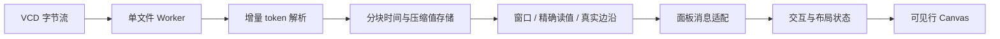

# 4.0 波形查看器

4.0.0-beta.6 面向 100–500 MB VCD 的日常 RTL 调试。它在后台加载文件，页面只接收
信号定义、可见行的时间窗口和精确游标值；文件大小不再决定 HTML 大小。

## 时序分析

- 搜索信号名或完整层级路径，按 scope 筛选并添加。稳定线网仍可查看，parameter 默认隐藏。
- 拖动目录右边界或信号名称/A-B读值栏右边界调整宽度；边界悬停高亮。双击或 Home 恢复默认，方向键每次8px、Shift每次32px，Escape取消拖动。
- 栏宽随同一文件布局保存；窗口缩小时暂时限制有效宽度，重新放大恢复用户设定。拖动只重绘，完成后更新窗口采样预算，A/B无需重复查询。
- 点击波形放置 A；Shift 点击放置 B。工具栏可切换活动游标，显示带符号的 B−A 时间差。
- “A ↔ B”适配游标区间；“全程 F”恢复全部范围。输入 `125 ns` 或裸 ticks 跳转。
- 名称栏选择边沿导航目标，左右箭头或工具栏跳到完整记录中的前后变更。
- Ctrl/Command + 滚轮在鼠标处缩放；Shift + 滚轮或拖动波形平移，普通滚轮滚动信号。
- 名称拖拽排序；Ctrl/Command 切换选择，Shift 从固定锚点选择连续范围，Ctrl/Command+Shift 扩展范围。
- 在已选信号上右键保留多选，在未选信号上右键只操作该行。菜单显示选中数量，打开后固定操作目标。
- “显示格式”子菜单包含整数、模拟量和浮点。混合位宽仅允许全部所选信号适用的格式，禁用项显示适用数量。
- 右键菜单显示信号名称/位宽或批量选择摘要，以及当前格式徽标；分组操作配线性图标，移除操作单独配色。
- 菜单项使用32px高度；主菜单232px、格式子菜单244px，字号、图标尺寸保持不变，长分组名称省略并保留完整提示。
- 悬停展开与切换收起有短暂缓冲，移入子菜单会保留当前层；屏幕边缘向左展开时箭头同步反向。
- 新建分组时 Enter 确认、Escape 取消；也可加入已有组或解除分组。组内按原行顺序保持连续，多选拖动整体排序。
- Analog/real 行的下边界可上下拖动调整行高；边界高亮并显示缩放光标。默认 100px，范围 60–480px，行高随布局保存。
- 名称区拖动有浮动信号预览、所选数量和插入线，其他行平滑让位；临近上下边缘可自动滚动。
- Escape、窗口失焦或指针取消会撤销未完成的缩放和排序；鼠标拖出波形区后松开也会结束手势。系统减少动态效果时跳过位移动画。
- 波形获得焦点后可用 Ctrl/Command+A 全选，Shift+F10 打开菜单；方向键导航子菜单，Escape 逐层返回并恢复焦点。
- SDec 按声明宽度解释二补码，包括 1-bit signed；总线使用 BigInt，避免 64/128-bit 精度损失。
- X 为红色，Z 为紫色，未初始化值显示“—”。未声明 timescale 时显示 ticks，不猜测单位。
- 标准十进制 timescale 的整数 tick 用 BigInt 换算标签，长时间轴仍能区分相邻 ns/fs。
- 选择、排序、进制、分组、行高、栏宽、时间范围和 A/B 游标由 webview 状态保存。

时间窗缩小时，一个像素中可能有多个跳变。返回首尾真实事件并明确标记发生省略的
密集区；放大后可辨认原始边沿。密集区不作为稳定值绘制，游标读值和边沿导航始终查询
未降采样的数据。模拟量轨迹同样遵守密集区标记，不能据缩小视图推断窄脉冲的峰值。

## 信号标记、总线展开和角色

选中一条或Ctrl/Command多选后右键，进入“背景高亮”，选择玫红、琥珀、草绿、青绿、天蓝或紫色；也可批量清除。颜色以淡底贯穿名称和波形，并在读值栏边界保留色条，不改变原轨迹及X/Z颜色。颜色随同文件布局恢复，普通多选底色继续存在；切色只重绘，不重读VCD。

多位数字总线名称左侧的三角、名称选中后的Enter和右键“展开总线为bit”均可展开；再次点击三角/Enter或右键“收起总线bit”收起。父总线保留，每bit可独立选取、着色、调整格式、分组、移动和删除。展开时继承父行已有颜色与分组；收起删除这些派生行及它们的局部设置，再次展开从父行重新继承。删除父行本身不强制删除已独立使用的bit。

按声明左界至右界排列，支持`[7:4]`、`[0:3]`、负下标和mem字；值始终按对应LSB偏移提取。VCD未记录范围时使用`width-1:0`位位置，悬停注明“位位置”，不冒充RTL范围。原VCD已独立dump的位不与派生位混为同一行。展开后的总行数最多2000；超限时菜单禁用并说明，不先分配宽总线所有子行。

bit的A/B读值精确提取；边沿导航及吸附跳过其它位的变化。边沿直接读压缩2-bit载荷，每次最多扫描10万总线事件，页面自动续查并可被新操作取代；不先解码整条宽总线。窗口的密集区域对bit保守沿用父总线密集标记，放大后再分辨，不把可能省略的脉冲当作稳定电平。

| 图标 | 含义 |
|---|---|
| 箭头进入边界 | 输入端口 |
| 箭头离开边界 | 输出端口 |
| 双箭头 | 双向端口 |
| 空心线网符号 | 已匹配RTL的内部声明 |
| 问号/未知符号 | 无法确认方向；悬停仍显示VCD wire/reg类型 |

普通VCD的[$var声明字段](https://pyvcd.readthedocs.io/en/latest/vcd.reader.html)不包含端口方向。插件只读发现当前工作区RTL，在VCD worker中复用语义解析器匹配顶层模块、实例和命名块，分别标注每条alias路径；同id跨层级可以一处为内部信号、一处为input。非ANSI端口的reg重声明保留其output角色。不按i_/o_前缀猜方向。

角色是打开波形时匹配源码的参考，不执行预处理或完整详细化；重复定义、单元内条件编译、无法映射的自动generate层级、转义层级或缺少源码保留未知。只读扫描最多512文件，单文件1MiB，总量8MiB，优先未保存正文；读取失败、超限或扫描不完整时统一保留未知，原因在元信息悬停和VCD输出日志中。不会openTextDocument、触发lint或修改RTL。重开波形重新匹配源上下文。

## 存储器查看

打开 VCD 后点击“存储器”，选择带地址的数组。`mem[addr]` 按地址列出 word，
`mem[row][col]` 按行列显示矩阵；packed 位范围如 `[15:8]` 只决定 word 位宽。
负地址、非零起点与稀疏记录保持原地址，独立层级中的同名数组分别选择。

表格共享波形 A/B 游标，显示两时刻的精确值，以 Δ 标记位值变化。整数和浮点选项与
波形共享格式目录，字宽不符的选项禁用；切换格式使用已缓存的 A/B 位值，不重新读取数据。
SDec 按 word 位宽解释。点击单元添加并选择对应波形，
可继续使用边沿导航。“定位”接受字地址或 `行,列`，箭头按页移动；当前页最多查询
64 个单元，快速换页和移动游标合并为最新任务。选择、分页、进制和面板开关随布局保存。

“—”表示该时刻没有初值，“未 dump”表示交叉地址没有信号记录，真实 X/Z 保持可见。
变化标记比较两个已知记录的位值；任一初值缺失时不判定变化。表格只使用文件里的单元，
不会据地址边界填充整个数组。同坐标存在不同 ID/packed 切片、word 位宽或维数冲突时，
不合并该数组，原信号仍可在普通波形里查看；入口提示无法归并的定义数量。

必须在仿真时 dump 所需单元；单独 `$dumpvars(0, top)` 不保证 simulator 导出全部 memory。
本仓库的 `test/fixtures/memory_dump.sv` 显式 dump 目标元素，并保留实际 Icarus 输出。
Icarus 13.0 在该样例中将二维 `mem[-1:1][2:4]` 展平成 `mem[0]`、`mem[2]` 等线性名称，
VCD 缺少原行列范围，查看器因此显示字数组。样例中的 escaped wire 别名
`\matrix[-1][2]` 等连接到同一真实 memory 元素，实际 dump 保留两个索引，用于矩阵验收。
其它 simulator 若保留两层索引，可直接使用矩阵视图。识别依据是 VCD 名称，不能恢复文件
没有记录的源码声明，也不能区分未带 packed range 的一位索引究竟来自数组还是 bus bit。

本版本仅支持 VCD；FSDB 查看开发按用户决定取消。

## 浮点显示

浮点格式解释 VCD 位向量，不对 `real/realtime` 再做位转换，也不推测一条宽总线里的多个浮点 lane。

| 格式 | 声明位宽 | 符号 / 指数 / 小数位 | 指数偏置 |
|---|---:|---|---:|
| FP64 | 64 | 1 / 11 / 52 | 1023 |
| FP32 | 32 | 1 / 8 / 23 | 127 |
| TF32 | 19 或 32 | 1 / 8 / 10 | 127 |
| BF16 | 16 | 1 / 8 / 7 | 127 |
| FP16 | 16 | 1 / 5 / 10 | 15 |
| FP8 (E3M4) | 8 | 1 / 3 / 4 | 3 |

FP64/FP32/FP16、BF16 的位域与分类参照 [NVIDIA 浮点说明](https://docs.nvidia.com/cuda/archive/13.1.0/cuda-programming-guide/05-appendices/mathematical-functions.html) 和 [RISC-V BF16 格式文档](https://github.com/riscv/riscv-bfloat16/blob/main/doc/riscv-bfloat16-format.adoc)。
支持正常数、非正规数、正负零、Inf 和 NaN；未知位继续显示 X/Z，不混作 NaN。
FP8 E3M4 是用户确认的项目编码约定，使用全 1 指数表示 Inf/NaN，并非 IEEE 754 定义的格式；未提供 E3M4FN。

TF32 的 19 位紧凑编码为 `S18 E17:10 M9:0`。32 位容器采用本查看器的显式 RTL 约定
`S31 E30:23 M22:13`，低 13 位必须为零；非零时显示“非规范 TF32”，不隐式截断或舍入 FP32。
此约定不代表 NVIDIA 的存储 ABI；[CUDA 官方 __nv_tf32 文档](https://docs.nvidia.com/cuda/cuda-math-api/cuda_math_api/struct____nv__tf32.html) 明确不保证其位布局。

波形数值随明暗主题采用清晰文字与细轮廓，取消矩形标签底色，保留总线自身的淡填充和 X/Z 颜色。
标签根据实际字宽缩略，不压扁字形；科学计数法保留完整指数，空间不足时隐藏该段标签。
标签省略不影响 A/B 的精确查询；存储器单元保留完整数值文本。

## 技术方向

| 文件 | 职责 |
|---|---|
| `parser.js` | 流和小文本入口共用 VCD 语法，报告出错位置。 |
| `store.js` | typed 时间与值 handle，2-bit 向量、real 字节池，alias 共用数据。 |
| `worker.js` / `session.js` | 流式读取、进度、请求与取消；关闭释放 worker。 |
| `host.js` / `index.js` | 页面握手、查询消息与 VS Code 注册。 |
| `model.js` | 时间、进制、范围和布局恢复的纯规则。 |
| `signal-display.js` | 背景色目录、方向图标事实、派生位身份及有界窗口投影。 |
| `source-roles.js` | 只读发现、有界RTL解析和角色匹配；不会推测缺失方向。 |
| `value-format.js` | 浮点编码目录、位宽校验、特殊值分类与解码；波形和 memory 共用。 |
| `interaction.js` | 无 DOM 的选择锚点、右键目标、分组与整体排序规则。 |
| `row-layout.js` | 行高边界、插入位置、预览布局与动画位置的纯几何规则。 |
| `row-gesture.js` | 行高与排序 Pointer 手势、取消、边缘滚动和预览生命周期。 |
| `column-layout.js` | 两栏请求宽度恢复、视口边界和名称/波形共享几何。 |
| `column-resize.js` | 分隔线 Pointer 捕获、取消、键盘调整和完成提交；不查询 VCD。 |
| `menu.js` | 子菜单的 DOM、键盘焦点、关闭和边缘定位。 |
| `memory.js` | 索引数组归并、冲突诊断、有界页与位值比较。 |
| `memory-view.js` | 存储器面板、地址定位、当前页精确值与过期响应抑制。 |
| `renderer.js` | 固定视口 Canvas，仅绘制可见行和时间窗。 |
| `client.js` | 虚拟信号列表、交互、查询合并和过期响应抑制。 |
| `view.js` / `view.css` | 不含事件数据的页面壳、nonce CSP 与明暗主题。 |

将解析计算移出宿主线程符合 [Node Worker 官方说明](https://nodejs.org/api/worker_threads.html)。
文件 I/O 使用异步流；每个打开的文件复用一个 worker，不为每次查询创建线程。

## 实测性能

以下为 alpha2 数据服务测量，后续波形显示改造沿用同一事件存储。Windows、Node 24.17.0；生成后使用热缓存读取。每个尺寸含 64 个独立信号、65 条声明
（含一个 alias），混合 clock、256-bit bus、稀疏控制信号及 real。旧版基线为 `869e4d1`。

| 指标 | 100 MiB 旧版 | 100 MiB 新版 | 500 MiB 新版 |
|---|---:|---:|---:|
| 加载耗时 | 4.006 s | 1.092 s | 5.329 s |
| 进程 RSS 峰值 | 1120 MiB | 183.6 MiB | 485.4 MiB |
| 宿主最大额外延迟 | 3996 ms | 14.36 ms | 13.39 ms |
| JSON 构造及查询耗时 | 687.8 ms | 48.06 ms | 66.66 ms |
| JSON 字节数 | 190.09 MB 全量事件基线 | 1.35 MB 视口 | 2.51 MB 视口 |

新版视口查询为 16 个 id、1200 像素，耗时包含 JSON 序列化。旧版全量事件 JSON 基线
不重复展开 alias；这列展示数据传输策略差异，不是相同工作量的查询速度对比，也不是
浏览器端到端时延。旧版 500 MiB 在隔离进程的 768 MiB JS heap 限制下耗尽堆内存退出。

可复现命令：`node scripts/benchmark-vcd.js --sizes 100,500 --out bin/vcd-benchmark`。
报告写入 `bin/vcd-benchmark/report.json`；默认移除本次脚本生成的大 VCD，保留结果。

## 验收边界

默认每个会话最多读取 2 GiB 文件，紧凑存储预算 512 MiB，worker JS heap 256 MiB；
超限会停止并显示原因。VCD 的事件密度、总线位宽与信号数决定实际内存，不能据一次
500 MiB 测量保证所有同尺寸文件都能加载。时间戳支持非负安全整数，超出精度范围报错。
超过 65536 bit 的总线显示带位宽标记的原始 VCD 缩略表达，避免巨型进制转换阻塞页面。

窗口与精确查询均设响应预算；页面只请求可见行，并合并快速缩放产生的过期任务。
信号目录和波形行均虚拟化；Canvas 位图尺寸随视口变化，不随信号总数增长。

自动测试覆盖 chunk 边界、别名、X/Z/real、同刻最终值、密集区和精确查询、资源边界、
页面注入防护、握手竞态及真实 worker 的取消释放。浏览器实测覆盖明暗主题、双游标、
区间缩放、搜索、进制、模拟量、导航和布局恢复；VS Code 宿主仍需安装包实机验收。
