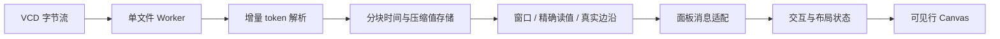

# 4.0 波形查看器

4.0.0-alpha3 面向 100–500 MB VCD 的日常 RTL 调试。它在后台加载文件，页面只接收
信号定义、可见行的时间窗口和精确游标值；文件大小不再决定 HTML 大小。

## 时序分析

- 搜索信号名或完整层级路径，按 scope 筛选并添加。稳定线网仍可查看，parameter 默认隐藏。
- 点击波形放置 A；Shift 点击放置 B。工具栏可切换活动游标，显示带符号的 B−A 时间差。
- “A ↔ B”适配游标区间；“全程 F”恢复全部范围。输入 `125 ns` 或裸 ticks 跳转。
- 名称栏选择边沿导航目标，左右箭头或工具栏跳到完整记录中的前后变更。
- Ctrl/Command + 滚轮在鼠标处缩放；Shift + 滚轮或拖动波形平移，普通滚轮滚动信号。
- 名称拖拽排序，Ctrl/Shift 多选后右键命名分组、移除或设置 Hex/Bin/Dec/SDec/Analog。
- SDec 按声明宽度解释二补码，包括 1-bit signed；总线使用 BigInt，避免 64/128-bit 精度损失。
- X 为红色，Z 为紫色，未初始化值显示“—”。未声明 timescale 时显示 ticks，不猜测单位。
- 标准十进制 timescale 的整数 tick 用 BigInt 换算标签，长时间轴仍能区分相邻 ns/fs。
- 选择、排序、进制、分组、行高、时间范围和 A/B 游标由 webview 状态保存。

时间窗缩小时，一个像素中可能有多个跳变。返回首尾真实事件并明确标记发生省略的
密集区；放大后可辨认原始边沿。密集区不作为稳定值绘制，游标读值和边沿导航始终查询
未降采样的数据。模拟量轨迹同样遵守密集区标记，不能据缩小视图推断窄脉冲的峰值。

## 存储器查看

打开 VCD 后点击“存储器”，选择带地址的数组。`mem[addr]` 按地址列出 word，
`mem[row][col]` 按行列显示矩阵；packed 位范围如 `[15:8]` 只决定 word 位宽。
负地址、非零起点与稀疏记录保持原地址，独立层级中的同名数组分别选择。

表格共享波形 A/B 游标，显示两时刻的精确值，以 Δ 标记位值变化。选择 Hex、Bin、
Dec 或 SDec 不重新读取数据；SDec 按 word 位宽解释。点击单元添加并选择对应波形，
可继续使用边沿导航。“定位”接受字地址或 `行,列`，箭头按页移动；当前页最多查询
64 个单元，快速换页和移动游标合并为最新任务。选择、分页、进制和面板开关随布局保存。

“—”表示该时刻没有初值，“未 dump”表示交叉地址没有信号记录，真实 X/Z 保持可见。
变化标记比较两个已知记录的位值；任一初值缺失时不判定变化。表格只使用文件里的单元，
不会据地址边界填充整个数组。同坐标存在不同 ID/packed 切片、word 位宽或维数冲突时，
不合并该数组，原信号仍可在普通波形里查看；入口提示无法归并的定义数量。

必须在仿真时 dump 所需单元；单独 `$dumpvars(0, top)` 不保证 simulator 导出全部 memory。
本仓库的 `test/fixtures/memory_dump.sv` 显式 dump 目标元素，并保留实际 Icarus 输出。
Icarus 13.0 在该样例中将二维 `mem[-1:1][2:4]` 展平成 `mem[0]`、`mem[2]` 等线性名称，
VCD 缺少原行列范围，查看器因此显示字数组。样例中的 escaped wire 别名
`\matrix[-1][2]` 等连接到同一真实 memory 元素，实际 dump 保留两个索引，用于矩阵验收。
其它 simulator 若保留两层索引，可直接使用矩阵视图。识别依据是 VCD 名称，不能恢复文件
没有记录的源码声明，也不能区分未带 packed range 的一位索引究竟来自数组还是 bus bit。

本版本仅支持 VCD；FSDB 查看开发按用户决定取消。

## 技术方向

| 文件 | 职责 |
|---|---|
| `parser.js` | 流和小文本入口共用 VCD 语法，报告出错位置。 |
| `store.js` | typed 时间与值 handle，2-bit 向量、real 字节池，alias 共用数据。 |
| `worker.js` / `session.js` | 流式读取、进度、请求与取消；关闭释放 worker。 |
| `host.js` / `index.js` | 页面握手、查询消息与 VS Code 注册。 |
| `model.js` | 时间、进制、范围和布局恢复的纯规则。 |
| `memory.js` | 索引数组归并、冲突诊断、有界页与位值比较。 |
| `memory-view.js` | 存储器面板、地址定位、当前页精确值与过期响应抑制。 |
| `renderer.js` | 固定视口 Canvas，仅绘制可见行和时间窗。 |
| `client.js` | 虚拟信号列表、交互、查询合并和过期响应抑制。 |
| `view.js` / `view.css` | 不含事件数据的页面壳、nonce CSP 与明暗主题。 |

将解析计算移出宿主线程符合 [Node Worker 官方说明](https://nodejs.org/api/worker_threads.html)。
文件 I/O 使用异步流；每个打开的文件复用一个 worker，不为每次查询创建线程。

## 实测性能

以下为 alpha2 数据服务测量，alpha3 未改事件存储或查询策略。Windows、Node 24.17.0；生成后使用热缓存读取。每个尺寸含 64 个独立信号、65 条声明
（含一个 alias），混合 clock、256-bit bus、稀疏控制信号及 real。旧版基线为 `869e4d1`。

| 指标 | 100 MiB 旧版 | 100 MiB 新版 | 500 MiB 新版 |
|---|---:|---:|---:|
| 加载耗时 | 4.006 s | 1.092 s | 5.329 s |
| 进程 RSS 峰值 | 1120 MiB | 183.6 MiB | 485.4 MiB |
| 宿主最大额外延迟 | 3996 ms | 14.36 ms | 13.39 ms |
| JSON 构造及查询耗时 | 687.8 ms | 48.06 ms | 66.66 ms |
| JSON 字节数 | 190.09 MB 全量事件基线 | 1.35 MB 视口 | 2.51 MB 视口 |

新版视口查询为 16 个 id、1200 像素，耗时包含 JSON 序列化。旧版全量事件 JSON 基线
不重复展开 alias；这列展示数据传输策略差异，不是相同工作量的查询速度对比，也不是
浏览器端到端时延。旧版 500 MiB 在隔离进程的 768 MiB JS heap 限制下耗尽堆内存退出。

可复现命令：`node scripts/benchmark-vcd.js --sizes 100,500 --out bin/vcd-benchmark`。
报告写入 `bin/vcd-benchmark/report.json`；默认移除本次脚本生成的大 VCD，保留结果。

## 验收边界

默认每个会话最多读取 2 GiB 文件，紧凑存储预算 512 MiB，worker JS heap 256 MiB；
超限会停止并显示原因。VCD 的事件密度、总线位宽与信号数决定实际内存，不能据一次
500 MiB 测量保证所有同尺寸文件都能加载。时间戳支持非负安全整数，超出精度范围报错。
超过 65536 bit 的总线显示带位宽标记的原始 VCD 缩略表达，避免巨型进制转换阻塞页面。

窗口与精确查询均设响应预算；页面只请求可见行，并合并快速缩放产生的过期任务。
信号目录和波形行均虚拟化；Canvas 位图尺寸随视口变化，不随信号总数增长。

自动测试覆盖 chunk 边界、别名、X/Z/real、同刻最终值、密集区和精确查询、资源边界、
页面注入防护、握手竞态及真实 worker 的取消释放。浏览器实测覆盖明暗主题、双游标、
区间缩放、搜索、进制、模拟量、导航和布局恢复；VS Code 宿主仍需安装包实机验收。
